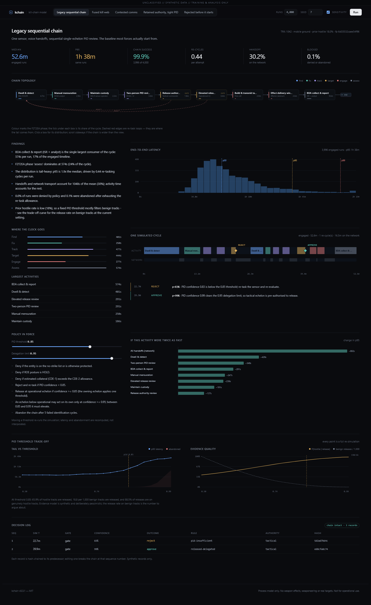
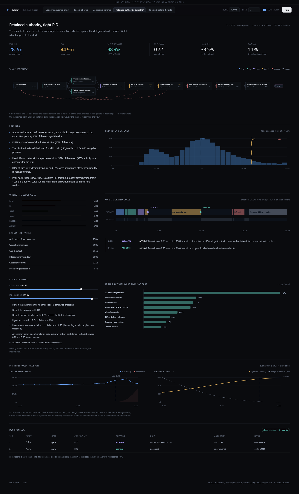

# kchain

A **kill-chain latency and authority simulator**: it models a targeting cycle as a
stochastic graph, runs it thousands of times, and shows you where the time
actually goes — and why the answer is almost never "the sensor".



No weapons. No weaponeering. No real targets. A process model, a policy engine
and an audit trail, over synthetic data. See [docs/SCOPE.md](docs/SCOPE.md) for
the exact boundary and [docs/DOCTRINE.md](docs/DOCTRINE.md) for how kill chains
actually work.

---

## What it does

- **Models the chain** as an activity network in the F2T2EA phases
  (find, fix, track, target, engage, assess), where every handoff costs time and
  every failed identification loops the chain back to the sensor.
- **Simulates it** with Monte Carlo, reporting p50/p95/p99 and success rate over
  engaged runs — not a single deterministic number.
- **Executes policy**: PID thresholds, delegation limits, release authority,
  ROE posture, collateral allowance and no-strike flags are real code, not a
  comment. The same policy object drives the simulation and the report.
- **Audits every decision**: a hash-chained log of confidence, rule, reason and
  authority for each gate, verifiable offline and tamper-evident.
- **Speaks CoT**: emits Cursor-on-Target XML so a synthetic track can be shown
  on a real TAK common operational picture.
- **Has an interface**: a local console with the chain graph, latency
  distribution, one-run timeline, sensitivity tornado, and live threshold
  sliders that re-simulate on drag.

## Quickstart

Python 3.10+, standard library only. No build step, no dependencies.

```bash
python -m kc check                              # validate every scenario
python -m kc list
python -m kc run 01-legacy-sequential           # full report
python -m kc compare 01-legacy-sequential 02-fused-killweb
python -m kc sweep 04-tight-roe                 # PID threshold trade-off
python -m kc audit 04-tight-roe --tamper-demo   # decision log + tamper check
python -m kc cot 02-fused-killweb --out t.cot   # Cursor-on-Target XML
python -m kc serve --open                       # analyst console
```

Tests: `python -m unittest discover -s tests` (71 tests, ~6 s).

## The five scenarios

Same target class, different machines. All synthetic.

| Scenario | What changes | p50 | p95 | Network | Blocked |
|---|---|---|---|---|---|
| `01-legacy-sequential` | one sensor, voice handoffs, retained authority | 52.6 m | 1 h 41 m | 30% | 0.1% |
| `02-fused-killweb` | multi-INT fusion, model-assisted PID, delegated release, M2M tasking | **13.5 m** | **20.8 m** | 12% | 0% |
| `03-contested-comms` | scenario 02 over a degraded, jammed network | 22.0 m | 34.6 m | 41% | 0% |
| `04-tight-roe` | scenario 02 with authority retained two echelons up, PID floor at 0.90 | 28.1 m | 45.0 m | 34% | 1.2% |
| `05-cde-denied` | scenario 04 where the collateral estimate exceeds the allowance | — | — | — | **100%** |

20,000 runs each, seed 7. Reproduce with `python tools/headline.py`.



*`04-tight-roe` in the console. The branch after the tactical gate is the
escalation path: 40% of proposals leave for operational C2, which then applies the
same numeric threshold to the same evidence package.*

## What the model actually shows

**1. Integration is worth about 4×, and most of it is fewer re-cycles.**
Between `01` and `02` the median falls from 52.6 to 13.5 minutes and re-task
cycles per engagement fall from 0.46 to 0.09. Faster sensors help, but the large
win is that better evidence stops the chain from looping. Anyone selling a
sensor-only upgrade is optimising the wrong term.

**2. The network owns the tail.** `02` → `03` keeps every sensor and every
authority the same and only degrades transport: the median moves 1.6×, but p95
moves further and network time goes from 12% to 41% of the cycle. Retransmission
and re-cueing interact multiplicatively. Structural redundancy is worth more
than raw speed once failures dominate.

**3. Retained authority costs minutes and buys no decisions.** `04` has the same
evidence model as `02`, but release authority sits at the operational echelon and
the delegation limit is 0.96. About 40% of proposals escalate, adding a staff
package of roughly five minutes each — and then the higher echelon applies the
*same* numeric threshold to the *same* evidence package. That part of the latency
is procedural, not informational. (The rest of the gap between `02` and `04` is
the higher PID floor driving more re-cycles.) Accountability is a legitimate
thing to buy, but it should be priced honestly rather than discovered on the
clock.

**4. Some plans are infeasible, and you should find that early.** In `05` the
collateral estimate exceeds the commander's allowance, so every run is denied at
the first gate in about a minute. No sensor, network or tasking improvement moves
that number by a second. A planning tool that can say "this is not authorised"
cheaply is more valuable than one that can only say "here is a faster way to do
it".

**5. The PID threshold is a real trade-off, not a free parameter.** `kc sweep`
varies the threshold and reports both the simulated tail and the evidence-model
release rates. At the baseline scenario's prior of 18% hostile, the default
threshold releases about 66% of genuine targets while releasing roughly 2% of
benign tracks — which still means a meaningful share of releases land on the
wrong thing. Raising the threshold improves that ratio and sharply increases
abandonment. There is no setting that makes both numbers good; that is the
problem, not a bug in the model.

## How it works

```
scenario.json ──► Graph (typed nodes, probabilistic edges, recycle loops)
                      │
                      ▼
              Monte Carlo traversal ──► RunResult (timeline, decisions)
                      │                        │
                      ▼                        ▼
              statistics + sensitivity    audit log (hash chain)
                      │                        │
                      └──────► report / console / CLI / CoT ◄───┘
```

Each node has a duration distribution; each edge has a probability and a
handoff latency. Decision nodes call `doctrine.decide()` with the sampled
confidence, the policy and the echelon, then follow the matching edge. A
`reject` edge loops back to the sensor and re-samples confidence, which is what
produces the fat tail; `max_recycles` bounds it, and hitting the bound is an
`abandoned` outcome rather than a silent success.

Latency statistics are computed over **engaged** runs only, and reported
alongside the outcome mix. Averaging denials into a latency number is how people
talk themselves into a chain that does not work.

## Layout

```
kc/
  distributions.py   latency primitives (lognormal, triangular, beta, …)
  model.py           scenario schema, validation, graph + layout
  doctrine.py        PID / ROE / CDE / authority gate — the executable policy
  engine.py          traversal, Monte Carlo, phase and node accounting
  analysis.py        histogram, tornado, threshold sweep, insight text
  audit.py           append-only hash-chained decision log
  cot.py             Cursor-on-Target emitter (TAK interoperability)
  api.py             stdlib HTTP API + static server
  cli.py             command line
scenarios/           five synthetic chains
web/                 analyst console — vanilla JS, no build
tests/               71 tests
docs/                DOCTRINE.md (how kill chains work), SCOPE.md (limits)
tools/               headline.py (the table above)
```

## Adding a scenario

Drop a JSON file in `scenarios/` and run `python -m kc check`. The schema is
self-documenting by example — start from `02-fused-killweb.json`. Node ids are
free-form; `kind` must be one of `sensor`, `network`, `fusion`, `analysis`,
`decision`, `tasking`, `effector`, `assessment`; a `decision` node needs edges
labelled `approve` and `reject` (plus optionally `escalate` and `deny`), and its
probabilities come from policy rather than from the file.

## Limitations

- Distributions are invented shapes, not measurements. The *structure* of the
  result is the point; the minutes are illustrative.
- Parallel redundancy is modelled as a probabilistic degraded-mode branch, not
  as full multi-path availability. True kill-web analysis (P(at least one path
  closes within T)) is a natural next step.
- The simulation always runs a genuinely hostile track. False-engagement risk is
  therefore handled in the evidence model and the threshold sweep, not in the
  per-run loop.
- The audit chain is tamper-*evident*, not tamper-*proof*: anyone who controls
  the file can rewrite it and recompute the hashes. An external anchor or a
  signature is required for real assurance.
- Not accredited, not reviewed, not for operational use.

## License

MIT. See [LICENSE](LICENSE).
